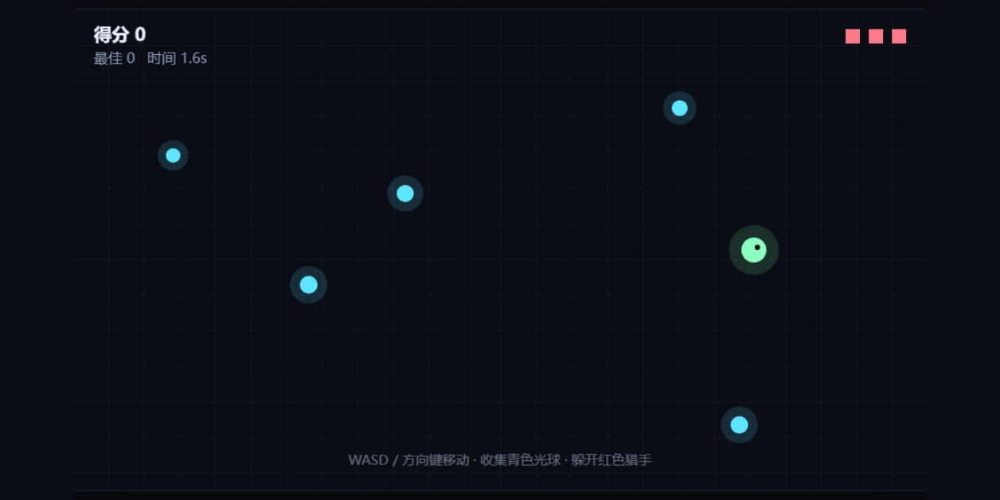

# game-anything

**English** | [简体中文](README.zh-CN.md)

An agent skill for building **playable games across engines** — Unity, Unreal, Godot, GameMaker,
Cocos Creator, Construct, RPG Maker, web engines (Canvas / Phaser / Three.js), code-first stacks
(Bevy, MonoGame, LÖVE, pygame, Raylib, LibGDX, HaxeFlixel, Ebitengine), and hosted platforms
(Roblox, Minecraft datapacks).

It is not a game library and not a code generator. It is a **workflow + toolchain** that an AI agent
loads so that "make me a game" ends in something that actually starts, renders, responds to input,
and can be shipped — instead of a pile of code nobody has ever run.

```
probe the project & toolchain → cut a vertical slice → build → verify → ship
```

## Why this exists

Most "AI made a game" attempts fail the same way: thousands of lines of plausible code that were
never executed. This skill makes **"it runs" the minimum bar** and ships deterministic verification
tools so the bar is checkable, not aspirational.

Four hard rules the skill enforces:

1. **Runnable beats complete.** A 5-minute playable slice first, features second.
2. **Never hand-write binary engine assets** (`.uasset`, `.umap`, `.unity`, `.meta`, `.prefab`).
   Generate them through engine APIs or edit text formats only.
3. **Only report what was verified.** No "should work" claims in the final report.
4. **Feel first, visuals second.** Input latency, feedback, and pacing before art polish.

## Install

```bash
git clone https://github.com/Alaneve541/game-anything.git "$HOME/.dsh/skills/game-anything"
```

On Windows: `%USERPROFILE%\.dsh\skills\game-anything`.

DeepSeek Harness watches the skills directory, so `game-anything` shows up in the skill catalog
immediately — no restart. Any agent session can then load it by name.

**Requirements**

- Node.js 18+ (the bundled tools use the built-in `fetch` and `WebSocket`).
- Microsoft Edge or Google Chrome for headless web verification.
- Game engines are optional: install only the engine you target.

## Quick start

Ask an agent:

> "Use game-anything to build a 2D tower-defense prototype that runs in the browser."

or, in Chinese:

> "用 game-anything 做一个能跑的平台跳跃小游戏。"

The skill will:

1. run `scripts/detect-engine.mjs` to identify the project, engines, and toolchain on the machine;
2. converge scope into a one-page `DESIGN.md` and a vertical slice;
3. build engine-appropriate code with an engine-agnostic core;
4. verify with real runs (headless screenshot + state probe + input injection);
5. hand over a runnable build plus an honest list of what was and wasn't verified.

### Try the bundled template

A complete, runnable 2D game ("Orb Runner", Canvas, single file) ships in `templates/web-canvas`:

```bash
# terminal 1
node scripts/serve.mjs --root templates/web-canvas --port 8123

# terminal 2 — headless Edge/Chrome, screenshot + state + key press
node scripts/verify-web.mjs \
  --url "http://127.0.0.1:8123" \
  --out shot.png \
  --wait-for "window.__game && window.__game.ready" \
  --press KeyD:1000
```

Expected: exit code `0`, `errors 0`, a `state` JSON line showing the player moved, and `shot.png`.


## The tools

| Script | What it does |
|---|---|
| `scripts/detect-engine.mjs` | Scans a project directory and the machine: engine scores, install health (e.g. Unreal missing `Engine/Binaries/Win64`), toolchain (Node, .NET, browsers) and next-step suggestions. |
| `scripts/verify-web.mjs` | Headless Edge/Chrome over the DevTools protocol: waits for a probe, collects console/page errors, injects keys/clicks, evaluates JS, screenshots, exits non-zero on errors. |
| `scripts/serve.mjs` | Zero-dependency static file server (MIME table, directory-traversal protection, SPA fallback). |

`verify-web.mjs` flags worth knowing:

- `--press KeyD:1200` — hold one key for a custom duration; repeatable, executed in order.
- `--click 640,360` — single click at page coordinates (start buttons, menus, click-based games).
- `--ignore <regex>` — repeatable; matches error text and resource URLs. Ignored items are listed
  under `ignored` and do **not** fail the run.
- `--strict` — disables the default noise filter (favicon 404) when you want a zero-tolerance run.
- `--json` — full machine-readable report (`ignored`, `pressPlan`, `click`, canvas size, state).

The probe contract for a web game:

```js
window.__game = {
  ready: true,
  state: () => ({ t, score, hp, mode, entities: 3, player: { x, y } }),
  press: (code, ms) => {},
  reset: (seed) => {},
};
```

## Engine support — honest status

| Tier | Engines | Status |
|---|---|---|
| Verified end-to-end | Web / HTML5 (Canvas, Phaser, Three.js) | Runs and verifies headless on Windows + Edge 158 |
| Guided (engine must be installed) | Unity, Unreal Engine, Godot, GameMaker, Cocos Creator, RPG Maker MV/MZ | Complete build/test/verify command references; scripts are only exercised once the engine is present |
| Code-first recipes | Bevy, MonoGame, LÖVE, pygame, Raylib, LibGDX, HaxeFlixel, Ebitengine | Minimal runnable code per engine, no editor needed |
| No automation | Construct 3 | Manual `.c3p` export; no scriptable CLI |

If the target engine is missing, the skill degrades deliberately: web prototype for feel, pure-logic
core with deterministic tests, migration plan — rather than pretending a build succeeded.

## Repository layout

```
SKILL.md                # the skill body the agent loads (Chinese, canonical)
references/             # 12 deep-dive docs: engines, architecture, verification, assets, shipping
scripts/                # detect-engine.mjs, verify-web.mjs, serve.mjs
templates/web-canvas/   # runnable Canvas game with probe, save, audio
docs/en/quickstart.md   # English walkthrough
docs/assets/            # screenshots
```

## Limitations

- Binary engine assets are never authored by hand; some content (models, levels) still needs an
  engine editor or API-generated build.
- Engine-specific commands are verified references, not substitutes for an installed engine.
- Store submission is a checklist, not automation (Steam/itch/WeChat store consoles stay manual).
- Game feel and balance need iteration; the skill guarantees a runnable, verifiable baseline.

## License

No license file yet. Pick one (MIT is a common default) before redistributing or accepting
contributions.
