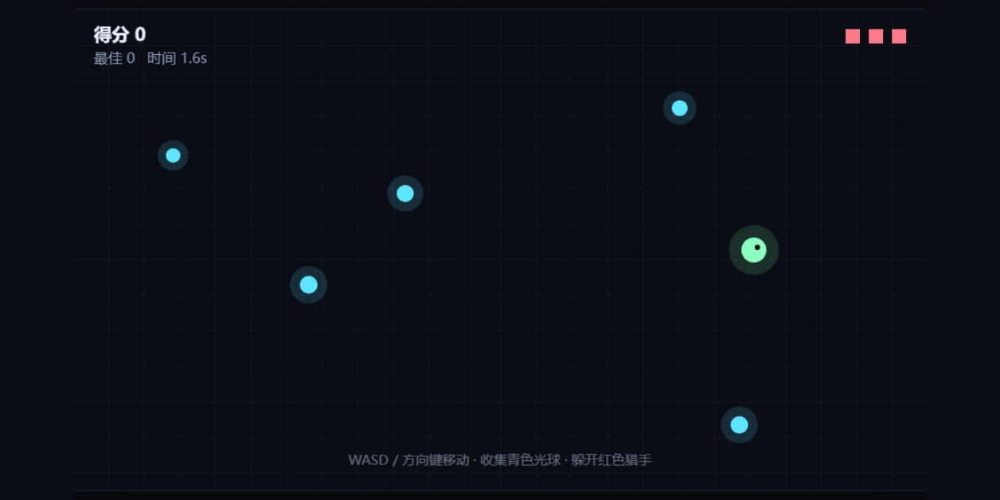

# game-anything

[English](README.md) | **简体中文**

一个用于**跨引擎制作可玩**游戏的 agent skill——覆盖 Unity、Unreal、Godot、GameMaker、
Cocos Creator、Construct、RPG Maker，Web 引擎（Canvas / Phaser / Three.js），代码优先技术栈
（Bevy、MonoGame、LÖVE、pygame、Raylib、LibGDX、HaxeFlixel、Ebitengine），以及托管平台
（Roblox、Minecraft 数据包）。

它不是游戏库，也不是代码生成器。它是一套**工作流 + 工具链**，让 AI agent 在接到
"做个游戏" 时，交付的是**能启动、能渲染、能响应输入、能发布**的东西，而不是一堆没人跑过的代码。

```
探测工程与工具链 → 切出垂直切片 → 实现 → 验证 → 交付
```

## 为什么需要它

大多数 "AI 做了个游戏" 的失败方式都一样：成千上万行看起来合理、但从未执行过的代码。
这个 skill 把**"能跑"设为最低标准**，并提供确定性的验证工具，让这个标准**可检查**而不是口号。

四条硬规则：

1. **能跑 > 完整**：先交 5 分钟可玩的垂直切片，功能往后放。
2. **资产由工具与引擎 API 生成，绝不手写二进制字节**：模型走 Blender headless 或程序化网格；
   关卡、Prefab 与场景由 UE Python / Unity Editor 脚本 / Godot 工具脚本生成，或来自 JSON 关卡数据。
   `.uasset`、`.umap`、`.unity`、`.yy` 永远不用文本编辑器碰。
3. **只报告验证过的结果**：最终报告里不出现 "应该能跑"。
4. **先手感后画面**：操作延迟、反馈、节奏优先于美术打磨。

## 安装

```bash
git clone https://github.com/Alaneve541/game-anything.git "$HOME/.dsh/skills/game-anything"
```

Windows 路径：`%USERPROFILE%\.dsh\skills\game-anything`。

DeepSeek Harness 会监听 skills 目录，克隆后 `game-anything` 立刻出现在技能目录里，无需重启，
任何会话都可以按名字加载。

**依赖**

- Node.js 18+（内置工具使用原生 `fetch` 与 `WebSocket`）。
- Microsoft Edge 或 Google Chrome（用于无头 Web 验证）。
- 游戏引擎可选，只装你要做的那个。

## 快速开始

直接对 agent 说：

> "用 game-anything 做一个能跑的平台跳跃小游戏。"

或英文：

> "Use game-anything to build a 2D tower-defense prototype that runs in the browser."

skill 会：

1. 运行 `scripts/detect-engine.mjs`，识别工程、本机已装引擎与工具链；
2. 把需求收敛成一页 `DESIGN.md` 与垂直切片；
3. 用引擎无关的 core 实现目标引擎的适配层；
4. 用真实运行验证（无头截图 + 状态探针 + 注入输入）；
5. 交付可运行产物，并附上"验证过 / 未验证"的诚实清单。

### 跑一下自带模板

`templates/web-canvas` 是一个完整可运行的 2D 小游戏（"Orb Runner"，Canvas 单文件）：

```bash
# 终端 1
node scripts/serve.mjs --root templates/web-canvas --port 8123

# 终端 2 —— 无头 Edge/Chrome，截图 + 状态 + 按键
node scripts/verify-web.mjs \
  --url "http://127.0.0.1:8123" \
  --out shot.png \
  --wait-for "window.__game && window.__game.ready" \
  --press KeyD:1000
```

预期：退出码 `0`、`errors 0`、`state` JSON 显示角色确实移动、并生成 `shot.png`。



## 工具

| 脚本 | 作用 |
|---|---|
| `scripts/detect-engine.mjs` | 扫描工程目录与本机：引擎评分、安装完整性（如 Unreal 缺 `Engine/Binaries/Win64`）、工具链（Node、.NET、浏览器）与下一步建议。 |
| `scripts/verify-web.mjs` | 基于 DevTools 协议的无头 Edge/Chrome：等探针、收集 console/page 错误、注入按键/点击、执行 JS、截图，出错时返回非 0。 |
| `scripts/serve.mjs` | 零依赖静态服务器（MIME 表、防目录穿越、SPA 回退）。 |
| `scripts/prepare-engine.mjs` | 把"引擎没装"变成可执行步骤：Godot 自动下载解压并自检（`--headless --version`）；Unity Hub 静默安装（编辑器与许可证需一步人工/CI）；Unreal 检查 `Engine/Binaries/Win64` 是否完整。默认 dry-run，`--apply` 才安装。 |
| `scripts/balance-sweep.mjs` | 无头批量跑种子对局（浏览器探针或 DOM 无关的 core 模块），输出 CSV，统计胜率、平均存活与分数分位数——数值是量出来的，不是猜的。 |
| `scripts/publish.mjs` | 统一发布入口：itch.io（butler）、Steam（steamcmd + SteamPipe VDF）、Web 打包/部署、微信小游戏 CLI、Gradle/Fastlane、Xcode archive。默认 dry-run，`--apply` 才执行；密钥走环境变量并在日志中脱敏。 |

`verify-web.mjs` 常用参数：

- `--press KeyD:1200` —— 给单个按键指定时长；可重复、按顺序执行。
- `--click 640,360` —— 在页面坐标点一次（开始按钮、菜单、点击类玩法）。
- `--ignore <regex>` —— 可重复，同时匹配错误文本与资源 URL；命中项列入 `ignored`，**不计入失败**。
- `--strict` —— 关闭默认噪音过滤（favicon 404），需要"零容忍"时用。
- `--json` —— 输出完整机器可读报告（`ignored`、`pressPlan`、`click`、canvas 尺寸、state）。

Web 游戏的探针契约：

```js
window.__game = {
  ready: true,
  state: () => ({ t, score, hp, mode, entities: 3, player: { x, y } }),
  press: (code, ms) => {},
  reset: (seed) => {},
};
```

## 引擎支持（诚实状态）

| 层级 | 引擎 | 状态 |
|---|---|---|
| 端到端验证过 | Web / HTML5（Canvas、Phaser、Three.js） | 在 Windows + Edge 158 上真实跑通并验证 |
| 有指导文档（需自行安装引擎） | Unity、Unreal Engine、Godot、GameMaker、Cocos Creator、RPG Maker MV/MZ | 完整构建/测试/验证命令参考；引擎装好后才能实测脚本 |
| 代码优先配方 | Bevy、MonoGame、LÖVE、pygame、Raylib、LibGDX、HaxeFlixel、Ebitengine | 每个引擎都有最小可运行代码，无需编辑器 |
| 无自动化 | Construct 3 | 只能手动导出 `.c3p`，无脚本化 CLI |

如果目标引擎缺失，skill 不会停在"你自己去装"：`prepare-engine.mjs` 能全自动装好 Godot（便携
zip）、静默安装 Unity Hub、并精确报告 Unreal 缺哪个二进制。之后才降级为 Web 原型 + 移植清单——
并且绝不会在引擎构建没跑通时声称成功。

## 内容与数值同样脚本化

- `templates/blender/gen_props.py` —— Blender headless：生成道具、材质，导出 GLB/FBX。
- `templates/ue/gen_assets.py` —— UE 编辑器 Python：导入模型、摆放 actor、保存关卡。
- `templates/unity/Editor/BuildTools.cs` —— Unity `-executeMethod`：程序化网格、Prefab、场景。
- `templates/godot/tools/gen_content.gd` —— Godot 工具脚本：`ArrayMesh` → `.tres`、`.tscn` 场景。
- `node scripts/balance-sweep.mjs --url http://127.0.0.1:8123 --seeds 1-100 --seconds 90` ——
  批量跑、出 CSV、汇总胜率/存活/分位数；`--core dist/core.mjs` 可跑更快的纯逻辑扫描。

## 仓库结构

```
SKILL.md                # agent 加载的技能正文（中文，权威版本）
references/             # 15 篇深水区文档：引擎、架构、素材流水线、平衡实验室、
                        # 验证、发布自动化、素材与音频、平台发布
scripts/                # detect-engine、prepare-engine、verify-web、balance-sweep、publish、serve
templates/web-canvas/   # 可运行 Canvas 游戏，含探针、存档、音效
templates/blender/      # Blender headless 道具生成（GLB/FBX）
templates/ue/           # Unreal 编辑器 Python 资产 + 关卡生成
templates/unity/        # Unity 编辑器批量内容生成
templates/godot/        # Godot 工具脚本内容生成
docs/en/quickstart.md   # 英文快速上手
docs/assets/            # 截图
```

## 自动化覆盖（原「局限」项）

| 领域 | 现在怎么自动化 | 仍需人工的部分 |
|---|---|---|
| 模型 / 关卡 / Prefab | Blender headless；UE Python、Unity Editor、Godot 工具脚本；JSON 关卡数据 | 美术方向决策 |
| 引擎准备 | `prepare-engine.mjs`：Godot 全自动；Unity Hub 静默安装；Unreal 完整性检查 | Unity 许可证激活；Unreal 30–80 GB 安装包 |
| 发布 | `publish.mjs`：butler、steamcmd、Web 打包/部署、微信 CLI、Gradle/Fastlane、Xcode archive | 首次登录、2FA、商店审核提交 |
| 平衡与手感 | `balance-sweep.mjs`：种子批量跑、CSV、胜率/存活/分位数 | 最终主观打磨 |

真正无法自动化的只剩：平台审核、账号登录/2FA、以及没有引擎二进制时凭空构建。其余都是命令。

## 许可

暂未添加 LICENSE 文件。对外分发或接受贡献前，请先选定许可证（MIT 是常见默认选项）。
